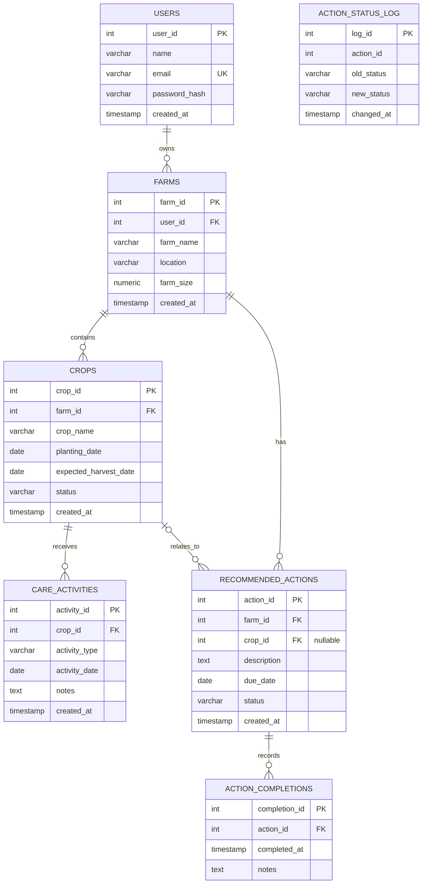

# AgriPilot – Entity Relationship Diagram (ERD)

This diagram represents the PostgreSQL assessment database for AgriPilot.

## Database Entities and Relationships

## Relationship Explanation

| Relationship | Meaning |
|---|---|
| USERS → FARMS | One user can own multiple farms. |
| FARMS → CROPS | One farm can contain multiple crops. |
| CROPS → CARE_ACTIVITIES | One crop can have multiple care activities. |
| FARMS → RECOMMENDED_ACTIONS | One farm can have multiple recommended actions. |
| CROPS → RECOMMENDED_ACTIONS | A crop can be associated with multiple actions; the crop reference is optional. |
| RECOMMENDED_ACTIONS → ACTION_COMPLETIONS | One action can have multiple completion records. |

## Key Explanation

- **PK:** Primary Key – uniquely identifies a record.
- **FK:** Foreign Key – references a record in another table.
- **UK:** Unique Key – prevents duplicate values.
- **1:N:** One-to-many relationship.

## Audit Table

`ACTION_STATUS_LOG` records changes in recommended action status.

Its `action_id` is not declared as a foreign key in the current PostgreSQL schema. Therefore, no formal relationship line is drawn to another table.

## Database Note

PostgreSQL is used as a separate database assessment component. The current running AgriPilot application uses MongoDB.
