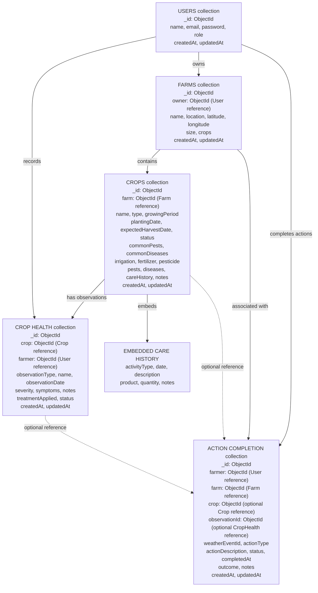

# AgriPilot MongoDB Data Model

## 1. Overview

AgriPilot uses MongoDB as its main application database. The database is managed through Mongoose models in the Node.js backend.

The data model defines how users, farms, crops, crop health observations, and completed farming actions are stored and connected.

## 2. Main Collections

AgriPilot currently has five Mongoose models:

1. **Users** – stores user account information and roles.
2. **Farms** – stores farm details and links each farm to its owner.
3. **Crops** – stores crop information and links each crop to a farm.
4. **CropHealth** – stores observations about crop pests, diseases, and other health issues.
5. **ActionCompletion** – stores records of actions completed by farmers.

## 3. Relationships

1. A User can own multiple Farms.
2. Each Farm references its owner through the `owner` field.
3. A Farm can have multiple Crop documents.
4. Each Crop references its Farm through the `farm` field.
5. A Crop can have multiple CropHealth observations.
6. Each CropHealth observation references a Crop through `crop` and a User through `farmer`.
7. A User can have multiple ActionCompletion records.
8. Each ActionCompletion references a User through `farmer` and a Farm through `farm`.
9. An ActionCompletion can optionally reference a Crop through `crop`.
10. An ActionCompletion can optionally reference a CropHealth observation through `observationId`.

## 4. Embedded Data

The following information is embedded inside Crop documents:

- Care history
- Irrigation information
- Fertilizer information
- Pesticide information

These are embedded fields or subdocuments, not separate MongoDB collections.

**Important:** The `Farm.crops` field is an array of strings, not references to Crop documents. The actual Farm-to-Crop relationship is established through `Crop.farm`.

## 5. Mermaid Diagram

## 6. Important Notes

- The diagram represents the five Mongoose models shared from the backend.
- ObjectId references connect related documents across collections.
- Care history, irrigation, fertilizer, and pesticide information are embedded in Crop documents.
- The `crop` and `observationId` fields in ActionCompletion are optional references.
- The `weatherEventId` field is a string identifier, not a reference to a separate Weather collection.
- This diagram describes the current MongoDB application model, not the separate PostgreSQL assessment database.

## 7. Conclusion

The AgriPilot MongoDB data model separates user, farm, crop, crop health, and action completion information into distinct collections. References connect related documents, while frequently associated crop information is embedded within Crop documents. This structure supports farm management, crop monitoring, and tracking completed farming actions.